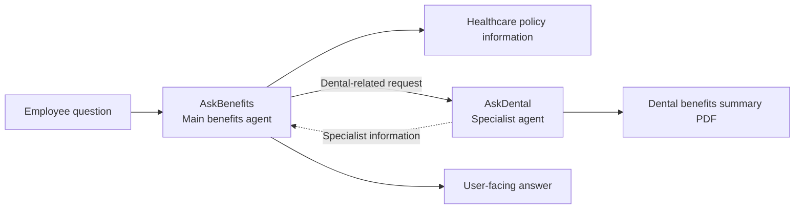
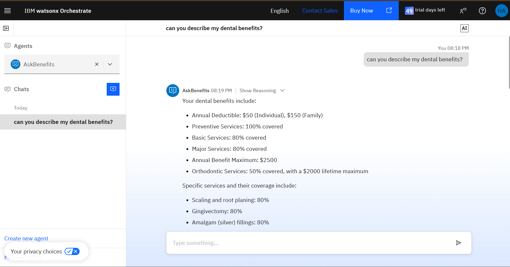
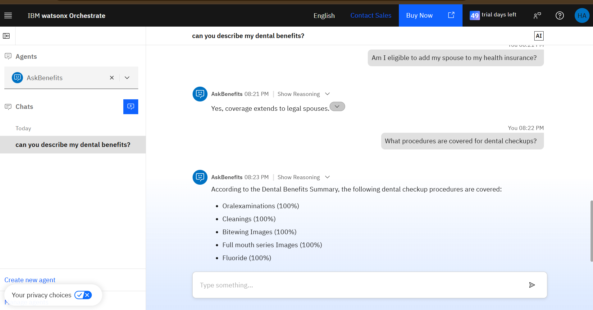
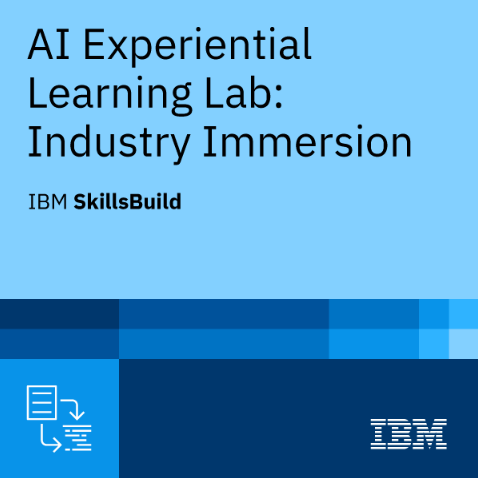

# Multi-Agent Healthcare Benefits Assistant

**IBM SkillsBuild AI Experiential Learning Lab | IBM watsonx Orchestrate**

A prototype AI assistant built to make employee healthcare and dental benefits easier to understand. During IBM SkillsBuild's AI Experiential Learning Lab, I created two connected agents - **AskBenefits** and **AskDental** - to answer questions using sample benefits-policy information.

> **Project status:** Completed and demonstrated during the IBM SkillsBuild lab. The IBM trial has since expired, so the agents are not currently available as a live public application. The recorded demo and screenshots document the original working prototype.

## Watch the project demo

[Watch the narrated demonstration (MP4)](demo/IBM-AI-Project-Demo.mp4)

## Technical Documentation

For a detailed explanation of the multi-agent architecture, agent configurations, knowledge sources, development process, and testing methodology, see the [Technical Overview](docs/technical-overview.md).

## The problem

Employees often have to search long insurance-policy documents to answer basic questions about coverage, deductibles, eligibility, and dental procedures. Policy language can be difficult to interpret, and finding the right section takes time.

## The solution

I built a two-agent prototype in **IBM watsonx Orchestrate**:

| Agent | Responsibility |
| --- | --- |
| **AskBenefits** | Main assistant for general healthcare and benefits questions; configured with AskDental as a collaborator. |
| **AskDental** | Specialized assistant for dental coverage and procedures, supported by a dental benefits summary PDF. |

The design allows a user to start with AskBenefits while the system has a specialized dental agent available for dental-related requests. The collaboration setup was captured during development; the chat screenshots show end-user responses rather than an internal delegation trace.

## Architecture



**[View the actual agent collaboration configuration](screenshots/askbenefits-askdental-collaboration.jpg)**

## Technology and resources

- **IBM watsonx Orchestrate:** Created, configured, connected, and tested the agents.
- **IBM watsonx.ai Prompt Lab:** Explored foundation-model prompting in the lab workspace.
- **PDF policy documents:** Worked with an HR medical-benefits policy and a dental benefits summary as project reference material.
- **OpenAPI / YAML:** Examined a lab-provided tool specification. It is not redistributed here; the presence of tool definitions alone does not establish that every listed API operation was used in the final demonstration.
- **Screen recording and AI narration:** Prepared a portfolio-ready walkthrough of the prototype.

## How I built it

1. Explored IBM watsonx.ai Prompt Lab and saved an **AskBenefits** prompt session.
2. Imported the lab's reference assets, including medical-policy information and a YAML tool specification.
3. Created the **AskDental** agent and connected its dental benefits summary PDF as a knowledge source.
4. Created **AskBenefits** as the main healthcare benefits assistant.
5. Added **AskDental** as a collaborator within AskBenefits' agent toolset.
6. Deployed and tested the prototype with representative benefits questions.
7. Recorded a demonstration and submitted the project through the IBM lab platform.

## Demonstration and test results

These are observations from the recorded prototype using **sample policy documents**, not statements about anyone's actual insurance coverage.

| Test | Question asked | Observed response |
| --- | --- | --- |
| **1 - Dental benefits overview** | "Can you describe my dental benefits?" | Summarized deductibles, preventive/basic/major services, annual benefit maximums, and orthodontic coverage. |
| **2 - Spouse eligibility** | "Am I eligible to add my spouse to my health insurance?" | Responded that coverage extends to legal spouses under the example policy. |
| **3 - Dental checkups** | "What procedures are covered for dental checkups?" | Listed oral examinations, cleanings, specified X-ray images, and fluoride as covered preventive services in the sample document. |

### Test 1: Benefits summary



### Tests 2 and 3: Eligibility and checkup procedures



## Additional development evidence

- [AskBenefits and AskDental collaboration setup](screenshots/askbenefits-askdental-collaboration.jpg)
- [AskDental PDF knowledge source](screenshots/askdental-knowledge-source.jpg)
- [watsonx.ai lab project assets](screenshots/watsonx-project-assets.jpg)
- [Project submission confirmation](screenshots/03-ibm-submission-confirmation.png)
- [Submission portal status](screenshots/04-final-project-submission.png)

## IBM SkillsBuild credentials

The lab experience also resulted in IBM SkillsBuild digital credentials:

| Credential | Evidence |
| --- | --- |
| **AI Experiential Learning Lab: Industry Immersion** | [View credential image](credentials/05-ibm-industry-immersion-credential.png) |
| **Build an AI Agent** | [View credential image](credentials/06-ibm-build-ai-agent-credential.png) |
| **Enterprise Design Thinking Practitioner** | [View credential image](credentials/07-ibm-design-thinking-credential.png) |



## What I learned

This project gave me hands-on experience with **agent configuration**, **multi-agent collaboration**, **policy-document grounding**, **prompt design**, and **testing AI responses against example user questions**. It also highlighted the importance of checking answers against source documents and communicating the limits of a prototype.

## Limitations and transparency

- This is an **educational prototype**, not a production HR or insurance system.
- The agents are **not currently live** because the IBM trial ended.
- Screenshots and video capture the application as it worked during the lab, not a presently hosted service.
- Responses shown were generated from **sample policies**. Coverage information should not be treated as professional insurance or medical advice.
- Internal routing is represented by the configured agent relationship; the public evidence does **not** independently prove the delegation path for every message.
- The original course guide, policy PDFs, and full YAML specification are retained privately rather than republished without confirming redistribution rights and endpoint safety.

## Repository structure

```text
IBM-Multi-Agent-Healthcare-Assistant/
|-- README.md
|-- credentials/
|-- demo/
|   `-- IBM-AI-Project-Demo.mp4
|-- docs/
`-- screenshots/
```

## Acknowledgment

Created as part of the **IBM SkillsBuild AI Experiential Learning Lab: Industry Immersion** experience.

**Project creator:** Hamzah
