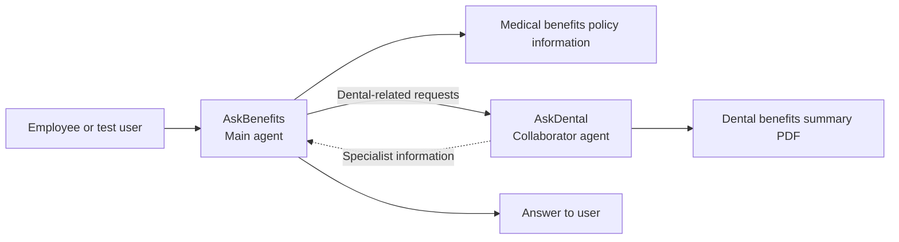

# Technical Overview: Multi-Agent Healthcare Benefits Assistant

**Program:** IBM SkillsBuild AI Experiential Learning Lab: Industry Immersion (2025)  
**Platform:** IBM watsonx Orchestrate, with exploratory work in IBM watsonx.ai Prompt Lab  
**Project:** AskBenefits + AskDental  
**Status:** Completed and demonstrated during the lab; not currently live because the IBM trial expired

> **Scope of this document:** This is a technical record of an educational prototype, reconstructed from saved agent-configuration screenshots, chatbot test outputs, the project demonstration, and the lab reference materials. It is **not** a deployment guide for a presently running service or a claim that every optional tool in the lab was used.

## 1. Problem and design goal

Employees may need to search lengthy health-insurance and dental-policy documents to find information about coverage, eligibility, deductibles, and preventive care. The prototype aimed to make these questions easier to ask in everyday language by using a main benefits assistant and a specialized dental assistant.

The solution was developed as a **multi-agent, document-supported conversational prototype** in IBM watsonx Orchestrate.

## 2. System components

| Component | Purpose | Evidence / qualification |
| --- | --- | --- |
| **AskBenefits** | Main user-facing agent for general healthcare and benefits questions | Visible in the original Orchestrate chat and agent setup screenshots |
| **AskDental** | Specialized collaborator for dental coverage questions | Created in Orchestrate; its knowledge-source screen and its addition to AskBenefits were captured |
| **Medical benefits policy** | Reference material covering general HR healthcare benefits | `HR_Policy_Medicalbenefits.pdf` was part of the lab's source material; the original document is retained privately |
| **Dental benefits summary** | Knowledge document for AskDental | `dental_benefits_summary.pdf` appears as a connected knowledge source in the saved screenshot |
| **Agent collaboration** | Makes AskDental available to AskBenefits for dental-related requests | The AskBenefits Toolset screenshot shows AskDental added as a collaborator |
| **watsonx.ai Prompt Lab** | Early experimentation with a saved prompt session | Saved project-assets screenshot includes `AskBenefits_Prompt` |
| **OpenAPI specification** | Describes lab-supplied healthcare tools | The original `ask_benefits_tools.yaml` defines nine API operations; see Section 5 for the evidence boundary |

## 3. High-level architecture

**How to interpret this diagram:** It represents the configured design and intended routing. The screenshots confirm that AskDental was added as a collaborator, and the chatbot responded to dental questions. They do **not** expose a complete internal execution trace proving the exact delegation path for every tested message.

[View the saved agent-collaboration configuration](../screenshots/askbenefits-askdental-collaboration.jpg)

## 4. Implementation sequence

The following summarizes the work documented during the lab:

1. **Explore Prompt Lab.** Opened the IBM watsonx.ai project workspace and worked with an `AskBenefits_Prompt` prompt session. Project assets included an HR policy PDF and a lab-provided YAML specification.
2. **Create AskDental.** Created the dental specialist in IBM watsonx Orchestrate.
3. **Add dental knowledge.** Uploaded and connected `dental_benefits_summary.pdf` to AskDental and supplied a description explaining its purpose as a dental-policy knowledge source.
4. **Create and configure AskBenefits.** Set up the main healthcare benefits assistant for user questions about general health benefits and eligibility.
5. **Connect the agents.** In AskBenefits > **Toolset > Agents**, added **AskDental** from the local Orchestrate instance as a collaborator.
6. **Deploy and test.** The working agent was available through Orchestrate's chat interface and was tested with three documented questions.
7. **Record and submit.** Recorded the real chatbot demonstration, produced a narrated portfolio video, and submitted the project through the IBM SkillsBuild lab portal.

The available screenshots are evidence of these milestones, but they are not a complete export of the original agent configuration.

## 5. Reference tool specification versus confirmed functionality

The lab supplied an OpenAPI 3.0 specification named `ask_benefits_tools.yaml`. It describes **nine available operations**:

| Operation in the provided specification | Intended capability |
| --- | --- |
| `query_historical_procedures` | Query historical medical procedures |
| `query_available_procedures` | Query available procedures and related information |
| `get_member_profile` | Retrieve a member profile |
| `schedule_appointment` | Schedule an appointment |
| `edit_appointment` | Edit an appointment |
| `cancel_appointment` | Cancel an appointment |
| `reschedule_appointment` | Reschedule an appointment |
| `list_appointments` | List appointments |
| `available_slots` | Retrieve available appointment slots |

**Evidence boundary:** These are operations defined in the *lab's supplied file*, not nine independently verified features of this project's recorded chatbot. The preserved three-question demo covers benefits and eligibility responses; it does not demonstrate appointment booking, cancellation, profile lookup, or the other API workflows. No claim is made here that all nine operations were attached to the final agent or invoked successfully.

The original specification contains a hosted backend URL and IBM-related request headers. To avoid publishing potentially active endpoints or materials without confirmed redistribution rights, the unmodified YAML file is **not included** in this public portfolio repository. No API secrets are needed to view the recorded evidence.

## 6. Knowledge-source configuration

### AskDental

- **Type:** PDF-based knowledge source in IBM watsonx Orchestrate.
- **Source document:** `dental_benefits_summary.pdf`.
- **Purpose:** Support answers about plan deductibles, covered dental procedures, preventive services, and other sample dental policy details.
- **Evidence:** [AskDental knowledge-source screenshot](../screenshots/askdental-knowledge-source.jpg).

### AskBenefits

- **Purpose:** Answer general health-benefits and eligibility questions and coordinate with the dental specialist when appropriate.
- **Reference document:** `HR_Policy_Medicalbenefits.pdf`, provided in the lab materials and shown among the saved project assets.
- **Evidence limit:** The saved project-assets screenshot establishes the file was present in the lab workspace, but is not by itself proof of every knowledge-source setting in the deployed AskBenefits agent.

The prototype used **sample policies**. Its responses should not be used to determine a person's real insurance coverage or eligibility.

## 7. Demonstration tests and observed outputs

Three questions were sent to the real AskBenefits chat interface. The results below report **what the saved chatbot responses said**, rather than a separate audit of policy accuracy.

| Test | User question | Recorded response |
| --- | --- | --- |
| **1: Dental benefits** | "Can you describe my dental benefits?" | Returned an overview including individual/family deductibles ($50/$150), preventive coverage (100%), basic and major services (80%), annual benefit maximum ($2,500), and orthodontic coverage (50% with a $2,000 lifetime maximum). |
| **2: Spouse eligibility** | "Am I eligible to add my spouse to my health insurance?" | Responded: "Yes, coverage extends to legal spouses." The reply is short and does not independently check an individual's complete eligibility circumstances. |
| **3: Dental checkups** | "What procedures are covered for dental checkups?" | Listed oral examinations, cleanings, bitewing images, full-mouth-series images, and fluoride as covered at 100% under the sample dental benefits summary. |

**Visual evidence:**

- [Test 1 — dental benefits response](../screenshots/01-dental-benefits-test.png)
- [Tests 2 and 3 — spouse eligibility and dental checkups](../screenshots/02-health-insurance-and-dental-tests.png)
- [Final narrated demonstration](../demo/IBM-AI-Project-Demo.mp4)

### What these tests establish

- A user could send natural-language benefits questions to AskBenefits.
- The deployed prototype produced detailed answers to dental and eligibility questions.
- The specialist-agent collaboration had been configured, as independently shown by the Toolset screenshot.

### What these tests do not establish

- A measured rate of answer accuracy across a large test set.
- Reliable internal delegation for every request; the preserved screenshots show the user-facing messages, not a full tool/agent trace.
- Integration with a real insurer, employee database, or appointment system.
- Successful execution of every API operation described in the separate YAML specification.

## 8. Validation approach and limitations

The demonstration used **three representative questions**, each compared at a high level with the topics covered by the sample benefits documents. This was a **functional demonstration**, not a formal benchmark or security assessment.

Important limitations:

- **Educational project:** The application was built for a training lab, not a production healthcare or HR environment.
- **Expired environment:** The IBM trial ended, and the agents are no longer accessible as a live application.
- **Limited observability:** The saved material does not include full orchestration traces, execution logs, model parameters, or exported agent configurations.
- **No independent metrics:** There are no measured accuracy, latency, reliability, privacy, or fairness results for the complete system.
- **Sample-only information:** Screenshots contain example policy values; the responses are not advice about a real person's insurance.

## 9. Evidence and submission record

| Artifact | Link |
| --- | --- |
| AskBenefits–AskDental collaborator setup | [Screenshot](../screenshots/askbenefits-askdental-collaboration.jpg) |
| AskDental connected knowledge PDF | [Screenshot](../screenshots/askdental-knowledge-source.jpg) |
| Prompt Lab and project reference assets | [Screenshot](../screenshots/watsonx-project-assets.jpg) |
| IBM project submission confirmation | [Screenshot](../screenshots/03-ibm-submission-confirmation.png) |
| Submission portal showing received entry | [Screenshot](../screenshots/04-final-project-submission.png) |
| Final video with AI narration | [MP4](../demo/IBM-AI-Project-Demo.mp4) |

The main [README](../README.md) provides the portfolio summary and links to the three IBM SkillsBuild credentials.

## 10. Public sharing and reproducibility

This repository is a **documentation and demonstration archive**, not a self-contained runnable application. It does not contain source code or configuration sufficient to recreate IBM's hosted agent service independently.

For safety and attribution, the original lab guide, policy PDFs, and unmodified OpenAPI YAML are retained privately rather than uploaded to this public repository. Any future rebuild would require a new authorized IBM watsonx environment, appropriate document permissions, renewed configuration of the agents, and fresh functional testing.

---

*Project by Hamzah — IBM SkillsBuild AI Experiential Learning Lab: Industry Immersion.*
